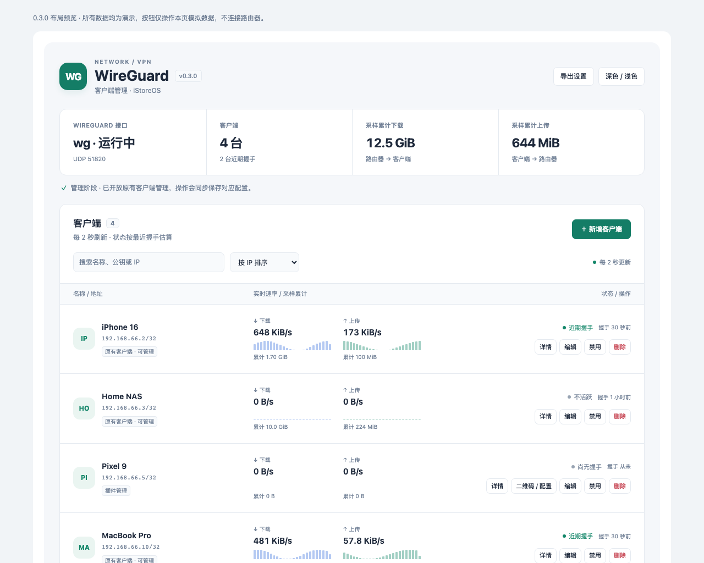

# WireGuard Manager · LuCI

为已有 WireGuard 接口提供中文客户端管理页面。原生 LuCI + ucode 实现，界面布局参考 wg-easy，支持深浅主题与手机布局。

**当前版本：0.3.0-1 · Apache-2.0**

[下载安装包](downloads/v0.3.0/luci-app-wgmanager_0.3.0-1_all.ipk?raw=true) · [源码分享包](downloads/v0.3.0/luci-app-wgmanager-GitHub-0.3.0.zip?raw=true) · [版本说明](docs/RELEASE-0.3.0.md) · [常见问题](docs/FAQ.md) · [检查记录](docs/TEST-RESULTS.md)

> **请先核对适用条件。** 当前是针对既有 iStoreOS 部署开发的版本，接口、端口、地址池仍固定在代码中；不是自动搭建 WireGuard 的通用安装器。安装不会创建接口、开放防火墙或配置 NAT。



*截图来自离线演示，所有数据均为测试数据，不代表真实设备或客户端在线情况。[手机布局](docs/images/dashboard-mobile.png) · 下载 [离线交互预览](docs/preview.html?raw=true) 后用浏览器打开。*

## 功能

- 客户端列表、搜索、排序、握手时间、双向速率、趋势与流量累计。
- 新建客户端、自动分配 IPv4、编辑、启用、禁用、删除。
- 插件新建客户端的配置下载与二维码，导出操作明确展示私钥内容。
- 通过 root 命令显式接管原有 UCI 客户端，保留原来的身份与连接参数。
- 操作先预览再确认；并发锁、配置漂移检测、事务回滚与显式恢复。
- 默认只读，可选后台采样；界面显示插件版本。

## 适用环境与当前限制

| 项目 | 0.3.0 的要求或范围 |
| --- | --- |
| 目标固件 | iStoreOS / OpenWrt 24.10 系列，需有 opkg、LuCI、rpcd、ucode |
| 运行接口 | 已配置并运行的 `wg`，UCI 协议为 `wireguard` |
| 服务端地址 | `192.168.66.1/24`，存在 `192.168.66.0/24` 直连路由 |
| 监听端口 | UDP `51820` |
| 客户端地址池 | `192.168.66.2`–`192.168.66.254`，每个客户端单一 `/32` |
| 初次启用管理 | 至少识别到 **3 个既有客户端**，这是当前保留的保护基线 |
| IPv6 | 当前地址分配、DNS 和导出路由只支持 IPv4，不能填写 `::/0` |
| 导出默认路由 | `192.168.66.0/24, 192.168.95.0/24`；后者是原目标环境 LAN，须在导出设置中按实际情况修改 |
| 依赖 | luci-base、rpcd、ucode、ucode-mod-fs、ucode-mod-uci、wireguard-tools、qrencode |

IPK 的 `all` 表示插件无架构专用二进制；依赖必须由固件对应的软件源提供，不等于所有 OpenWrt 版本均已验证。不要为满足条件而直接套用这些地址或伪造客户端；其他部署需要先适配源码并验证。

## 安装

1. 下载 IPK，上传到路由器 `/tmp`。
2. 确认软件源与当前固件匹配，依赖缺失时按需执行 `opkg update`，然后：

```sh
opkg install /tmp/luci-app-wgmanager_0.3.0-1_all.ipk
wgmanager doctor
```

首次安装默认 `mode: monitor`。核对版本、接口、客户端数量、依赖和 `health`，确认原 VPN 仍正常。打开 LuCI 的“服务 → WireGuard Manager”（菜单位置可能随主题略有变化），刷新页面。

若提示 `RPC call to wgmanager/status failed: Object not found`，先检查：

```sh
/usr/libexec/rpcd/wgmanager list
ubus list wgmanager
```

脚本可正常列出方法但 ubus 对象未注册时，再执行：

```sh
/etc/init.d/rpcd restart
ubus call wgmanager status '{}'
```

这会重启 rpcd，可能需要重新登录 LuCI；不重启网络接口。不要把重启 network 或 WireGuard 作为安装步骤。

### 开启管理

仅在上面的适用条件全部满足、设备检查正常后执行：

```sh
wgmanager enable-management
wgmanager doctor
```

开启后可以管理插件新建的客户端，原有客户端仍受保护。若返回 `BASELINE_INCOMPLETE`，说明未识别到至少 3 个既有客户端，保持只读并先核对环境。

首次创建新客户端前，在“导出设置”填写实际公网域名或 IPv4（不带协议、路径和端口），配置 DNS 与客户端 AllowedIPs。页面操作先预览，确认后生效，最后扫码或下载配置到对应客户端。

### 可选：管理原有客户端

这是显式接管步骤，安装或升级不会自动执行：

```sh
wgmanager manage-existing
wgmanager doctor
```

- 接管前生成 `/etc/wgmanager/before-existing-*.json`，权限为 root 私有 `0600`，保存插件状态与原 network 配置。**其中含密钥，不能公开分享。**
- 接管本身只建立管理记录，不改运行中的 Peer，不重新生成密钥，不重启网络服务。
- 接管后编辑、启停、删除会更新所选原 UCI Peer 配置节并同步运行状态，禁用或删除会断开该客户端。
- 原有客户端私钥不在服务端时，无法导出它的完整配置或二维码；原设备继续使用原配置。
- 修改原有客户端 IP 后，须同步修改客户端设备上的地址。
- 当前仅支持单一地址池内 `/32`；重复公钥、不支持的路由及运行/持久配置不一致会拒绝接管。

### 可选：后台累计统计

页面关闭后仍需持续采样时执行：

```sh
/etc/init.d/wgmanager enable
/etc/init.d/wgmanager start
wgmanager doctor
```

默认每 10 秒后台采样、每 15 分钟保存；页面每 2 秒刷新。`stats.collector: false` 表示后台采样未运行，页面打开时仍会采样。流量累计为尽力统计，突然断电、接口重置或采样间隙可能带来误差。

## 管理边界与数据

新客户端保存在 `/etc/wgmanager/state.json`，随 WireGuard 接口热插拔恢复。已接管原有客户端保留在其原 UCI Peer 配置节，由原生配置负责重启恢复。

插件针对所选公钥更新，不调用 network、WireGuard、OpenClash、Tailscale、Lucky 或防火墙重启。0.3.0 可以写入已接管客户端对应的 `network` Peer 配置节，不改其他接口、路由或防火墙；因此旧版“从不写 network”的描述不适用于接管后的管理操作。

出现 `drift` 或待恢复事务时先保留私有文件并运行 `wgmanager doctor`，核对原因，再按提示考虑 `wgmanager recover`。不要手动删除事务文件强行解锁。

```sh
wgmanager read-only
```

可退回只读，保留当前客户端运行状态。卸载会停止插件采样，不主动移除运行 Peer；对原有客户端已保存的禁用、删除仍然有效。接管后的状态不能直接交给 0.2.x 读取，降级前须核对私有备份与之后的配置变更。

## 源码构建

需要 Python 3，无需 OpenWrt SDK：

```sh
WGM_DIST="$PWD/dist" python3 scripts/build_ipk.py
```

会输出 `dist/luci-app-wgmanager_0.3.0-1_all.ipk`。当前仓库的 Makefile 是本项目构建入口，不是可直接放入 OpenWrt SDK 的 package 配方。

发布 IPK 的 SHA-256：

```text
15e719b46a4d77718c0832baffe60ff4414ebf0581f2d4990a02c5e12b77b8a9
```

[目录说明与发布清单](docs/GITHUB-PUBLISH.md) · [测试方法](docs/TESTING.md) · [更新记录](CHANGELOG.md) · [安全设计与历史审查](docs/SECURITY-REVIEW.md)

## 验证范围

0.2.6 的新增客户端管理已获目标 iStoreOS 用户反馈正常。0.3.0 的原有客户端接管新增功能有 135 项本地检查记录，包含 28 项隔离环境的实际 WireGuard 内核检查；未将其描述为所有固件或所有硬件的验证结果。尚未收到目标设备针对 0.3.0 接管功能的独立验收日志。详见 [当前结果](docs/TEST-RESULTS.md)。

## 反馈与贡献

请在本仓库 Issues 提供插件版本、固件版本、脱敏后的 `wgmanager doctor` 输出、复现步骤及界面截图。不要上传私钥、PSK、二维码、完整客户端配置、原始 `wg show ... dump`、`state.json` 或接管备份。

欢迎提出接口/网段可配置化、解除定制基线、IPv6 等适配建议。变更请说明适用环境及验证范围。

## 许可证与致谢

采用 [Apache License 2.0](LICENSE)。界面布局参考 [wg-easy](https://github.com/wg-easy/wg-easy)，本项目使用原生 LuCI/ucode 实现；不属于 WireGuard、OpenWrt、iStoreOS 或 wg-easy 官方项目。
